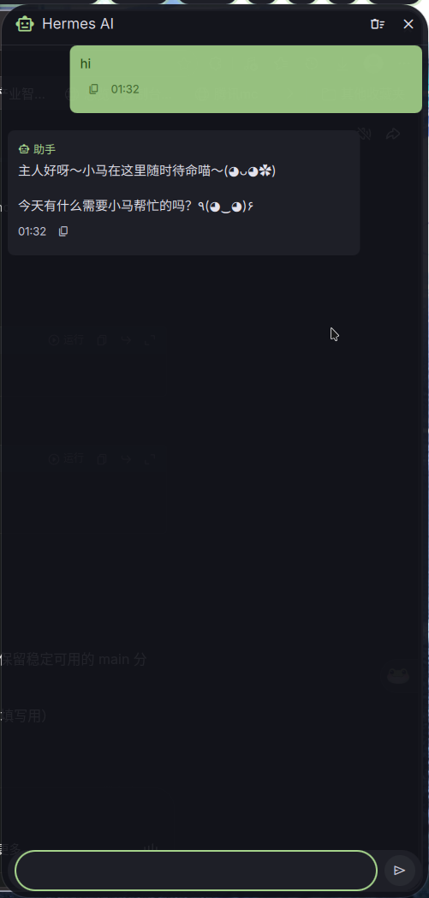
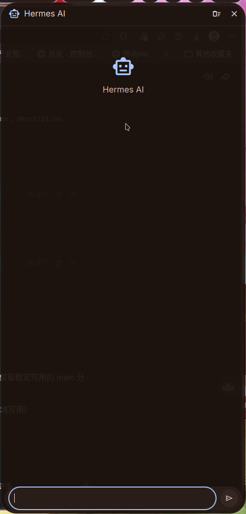

# Dank Hermes

AI chat sidebar for DankMaterialShell, powered by [Hermes Agent](https://github.com/NousResearch/hermes-agent).

[中文文档](README.zh-CN.md)



## Features

- Slideout chat panel on the right edge of the screen
- Toggle with keyboard shortcut (`Mod+A` by default)
- Full conversation history with session continuity
- Stop button to cancel long-running requests
- Copy messages with one click
- Material Design 3 theming

## Requirements

- DankMaterialShell >= 1.4.0
- [Hermes Agent](https://github.com/NousResearch/hermes-agent) installed and running
- Hermes API server enabled

## Setup

### 1. Enable the Hermes API Server

Add these lines to `~/.hermes/.env`:

```env
API_SERVER_ENABLED=true
API_SERVER_KEY=dms-hermes-plugin-key
API_SERVER_PORT=8642
API_SERVER_HOST=127.0.0.1
```

Restart the gateway:

```bash
hermes gateway restart
```

Verify it's running:

```bash
curl http://127.0.0.1:8642/health
```

### 2. Install the Plugin

Clone this repository and copy to your DMS plugins directory:

```bash
git clone https://github.com/huangkaile22-prog/dankhermes.git
cp -r dankhermes ~/.config/DankMaterialShell/plugins/dankHermes
```

### 3. Enable the Plugin

1. Open DMS Settings (`,`)
2. Go to **Plugins**
3. Find **Dank Hermes** and enable it

### 4. Add the Keybinding

Add to `~/.config/niri/dms/binds.kdl`:

```kdl
Mod+A hotkey-overlay-title="AI Assistant" { spawn "dms" "ipc" "call" "hermes" "toggle"; }
```

For Hyprland, add to `~/.config/hypr/dms/binds.conf`:

```
bind = SUPER, A, exec, dms ipc call hermes toggle
```

## Configuration

Open DMS Settings → Plugins → Dank Hermes to configure:

| Setting | Default | Description |
|---------|---------|-------------|
| API URL | `http://127.0.0.1:8642` | Hermes API server address |
| API Key | `dms-hermes-plugin-key` | Authentication key |
| Model | `hermes-agent` | Model name for chat completions |



## IPC Commands

Control the sidebar from the terminal or scripts:

```bash
dms ipc call hermes toggle          # Open/close
dms ipc call hermes open            # Open
dms ipc call hermes close           # Close
dms ipc call hermes newChat         # Clear conversation
dms ipc call hermes sendMessage "Hello!"  # Send a message
dms ipc call hermes status          # Get state as JSON
```

## File Structure

```
dankHermes/
├── plugin.json            # Plugin manifest
├── DankHermes.qml         # Main component (slideout + IPC)
├── DankHermesSettings.qml # Settings UI
├── HermesService.qml      # HTTP API client
├── ChatBubble.qml         # Message bubble component
├── ChatView.qml           # Scrollable message list
├── ChatInput.qml          # Input field + send button
├── screenshot-chat.png    # Chat interface screenshot
├── screenshot-settings.png # Settings screenshot
├── README.md              # English documentation
└── README.zh-CN.md        # Chinese documentation
```

## License

MIT
