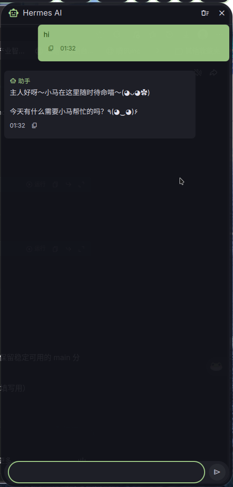
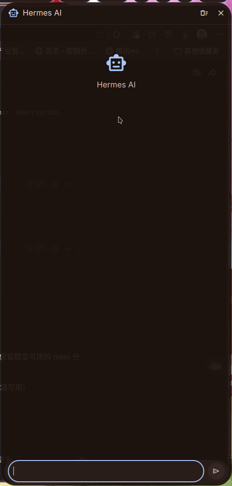

# Dank Hermes

DankMaterialShell 的 AI 聊天侧边栏插件，由 [Hermes Agent](https://github.com/NousResearch/hermes-agent) 驱动。

[English](README.md)



## 功能特性

- 从屏幕右侧滑出的聊天面板
- 快捷键切换（默认 `Mod+A`）
- 完整对话历史，支持会话连续
- 停止按钮可取消长时间运行的请求
- 一键复制消息
- Material Design 3 主题适配

## 环境要求

- DankMaterialShell >= 1.4.0
- 已安装并运行 [Hermes Agent](https://github.com/NousResearch/hermes-agent)
- Hermes API 服务器已启用

## 安装步骤

### 1. 启用 Hermes API 服务器

在 `~/.hermes/.env` 中添加以下配置：

```env
API_SERVER_ENABLED=true
API_SERVER_KEY=dms-hermes-plugin-key
API_SERVER_PORT=8642
API_SERVER_HOST=127.0.0.1
```

重启网关：

```bash
hermes gateway restart
```

验证是否正常运行：

```bash
curl http://127.0.0.1:8642/health
```

### 2. 安装插件

克隆本仓库并复制到 DMS 插件目录：

```bash
git clone https://github.com/hkl/dankhermes.git
cp -r dankhermes ~/.config/DankMaterialShell/plugins/dankHermes
```

### 3. 启用插件

1. 打开 DMS 设置（`,` 键）
2. 进入 **插件** 页面
3. 找到 **Dank Hermes** 并启用

### 4. 添加快捷键

在 `~/.config/niri/dms/binds.kdl` 中添加：

```kdl
Mod+A hotkey-overlay-title="AI Assistant" { spawn "dms" "ipc" "call" "hermes" "toggle"; }
```

Hyprland 用户在 `~/.config/hypr/dms/binds.conf` 中添加：

```
bind = SUPER, A, exec, dms ipc call hermes toggle
```

## 配置选项

打开 DMS 设置 → 插件 → Dank Hermes 进行配置：

| 设置项 | 默认值 | 说明 |
|--------|--------|------|
| API 地址 | `http://127.0.0.1:8642` | Hermes API 服务器地址 |
| API 密钥 | `dms-hermes-plugin-key` | 认证密钥 |
| 模型 | `hermes-agent` | 聊天补全使用的模型名称 |



## IPC 命令

在终端或脚本中控制侧边栏：

```bash
dms ipc call hermes toggle          # 打开/关闭
dms ipc call hermes open            # 打开
dms ipc call hermes close           # 关闭
dms ipc call hermes newChat         # 清空对话
dms ipc call hermes sendMessage "你好！"  # 发送消息
dms ipc call hermes status          # 获取状态 JSON
```

## 文件结构

```
dankHermes/
├── plugin.json            # 插件清单
├── DankHermes.qml         # 主组件（侧边栏 + IPC）
├── DankHermesSettings.qml # 设置界面
├── HermesService.qml      # HTTP API 客户端
├── ChatBubble.qml         # 消息气泡组件
├── ChatView.qml           # 可滚动消息列表
├── ChatInput.qml          # 输入框 + 发送按钮
├── screenshot-chat.png    # 聊天界面截图
├── screenshot-settings.png # 设置界面截图
├── README.md              # 英文说明文档
└── README.zh-CN.md        # 中文说明文档（本文件）
```

## 许可证

MIT
